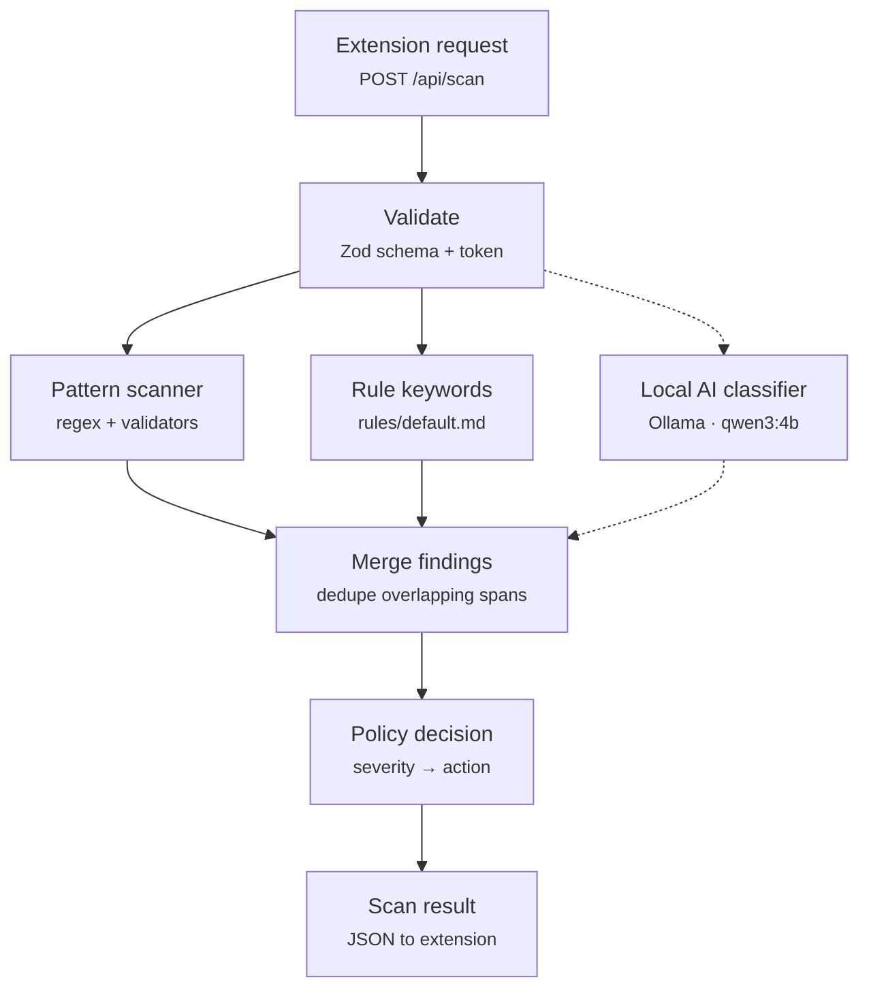

# PromptShield AI — backend design

Node.js + Express JSON API that the Chrome extension calls before a ChatGPT prompt is sent. Patterns and rules give fast, predictable results; the local Ollama model adds context. **The backend makes the decision, never the model.**

Based on the PromptShield AI proposal v1.0 (October 2026).

## Contents

- [How a scan works](#how-a-scan-works)
- [API contract](#api-contract)
- [What gets detected](#what-gets-detected)
- [Policy rules file](#policy-rules-file)
- [When things go wrong](#when-things-go-wrong)
- [Code layout](#code-layout)
- [Build plan](#build-plan)
- [Decisions for the team](#decisions-for-the-team)

## How a scan works



The dashed path is the local model. It's the only slow or failure-prone step, so everything else works without it.

| Step | Time | What it does |
| --- | --- | --- |
| **Extension request** | — | Sent by the extension's background service worker, not the ChatGPT content script. Body: `{ text, profile? }`. The prompt is never written to disk or logs. |
| **Validate** | < 1 ms | `text` must be 1–20,000 characters; unknown fields are rejected. Optional `X-PromptShield-Token` header check, since the server is reachable on the network. Bad input returns a 400 JSON error and nothing else runs. |
| **Pattern scanner** | < 5 ms | Always runs; the same input always gives the same findings. Email, PH phone numbers, payment cards (Luhn-checked), TIN, SSS, PhilHealth, UMID. Each finding has an exact `start`/`end` span. |
| **Rule keywords** | < 5 ms | Literal keywords from the Markdown rules: client names, project codenames, internal hostnames. Case-insensitive, whole-word matches. No custom regex in the MVP. |
| **Local AI classifier** | ~4 s warm, ~10 s cold | Finds what patterns can't: names, home addresses, health, salary, confidential business context. Answers in a fixed JSON schema (category, exact quote, reason). The backend finds each quote in the prompt to get its span and drops quotes it can't find. 15 s timeout. |
| **Merge findings** | < 1 ms | When spans overlap, the pattern or rule finding wins over the AI finding. Each remaining span gets one placeholder, e.g. `[EMAIL_1]`, `[NAME_2]`. |
| **Policy decision** | < 1 ms | Severity per category comes from the rules file. Risk level is the highest severity found; action is the strongest action triggered. The model can add findings but can never lower the risk set by patterns or rules. If the AI didn't finish, `on_ai_unavailable` sets the minimum action (default: `warn`). |
| **Scan result** | ~4 s total | `riskLevel`, `recommendedAction`, `findings[]` with spans, `redactedText`, `ai` status, timings. Nothing is stored server-side. |

> [!IMPORTANT]
> **Integration note for the extension team:** call the backend from the extension's background service worker, with `host_permissions` for `http://localhost:3000/*`. Requests from the content script run under the chatgpt.com origin and get blocked by CORS and Chrome's local-network checks.

## API contract

| Method & path | Purpose | Status |
| --- | --- | --- |
| `GET /health` | Is the backend up, and is the local model loaded? The extension polls this to show the local-AI indicator. | Done |
| `POST /api/scan` | The main call. Runs every detector, applies the policy, and returns findings plus a fully redacted draft. | Done |
| `POST /api/redact` | Re-redact using only the findings the user kept (they can untick false positives). Stateless: the extension sends the spans back. | Done |
| `GET /api/rules` | Active rules for the extension settings page. Metadata only. | Phase 4 |
| `POST /api/rules/validate` | Check a rules file before saving it. Parses and validates only; never applies or executes anything. | Phase 4 |

Every error, on every endpoint, is `{ "error": { "message": "..." } }` with a matching HTTP status.

### `GET /health`

```json
{
  "status": "ok",
  "localAi": {
    "reachable": true,
    "version": "0.40.2",
    "model": "qwen3:4b",
    "modelAvailable": true,
    "ready": true
  }
}
```

### `POST /api/scan`

Request:

```json
{
  "text": "Reply to Maria Santos at maria.santos@example.com about her refund.",
  "profile": "default",
  "useAi": true
}
```

`profile` and `useAi` are optional. `useAi: false` skips the local model and returns pattern results instantly with `ai.status: "skipped"`.

Response:

```json
{
  "riskLevel": "high",
  "recommendedAction": "redact_and_review",
  "findings": [
    {
      "id": "f1",
      "category": "person_name",
      "severity": "medium",
      "source": "ai",
      "start": 9,
      "end": 21,
      "match": "Maria Santos",
      "placeholder": "[NAME_1]",
      "reason": "Names a specific customer"
    },
    {
      "id": "f2",
      "category": "email",
      "severity": "high",
      "source": "pattern",
      "start": 25,
      "end": 49,
      "match": "maria.santos@example.com",
      "placeholder": "[EMAIL_1]",
      "reason": "Email address"
    }
  ],
  "redactedText": "Reply to [NAME_1] at [EMAIL_1] about her refund.",
  "ai": { "status": "completed", "model": "qwen3:4b", "latencyMs": 3680 },
  "rulesVersion": "default@1"
}
```

| Field | Values |
| --- | --- |
| `riskLevel` | `none` · `low` · `medium` · `high` |
| `recommendedAction` | `allow` · `warn` · `redact_and_review` · `block` |
| `findings[].source` | `pattern` · `rule` · `ai` |
| `ai.status` | `completed` · `skipped` · `unavailable` · `timeout` · `invalid_output` |

### `POST /api/redact`

Request:

```json
{
  "text": "Reply to Maria Santos at maria.santos@example.com about her refund.",
  "findings": [
    { "start": 25, "end": 49, "category": "email" }
  ]
}
```

Response:

```json
{
  "redactedText": "Reply to Maria Santos at [EMAIL_1] about her refund.",
  "replacements": [
    { "start": 25, "end": 49, "category": "email", "placeholder": "[EMAIL_1]" }
  ]
}
```

Spans must be inside the text and must not overlap; otherwise the response is a 400 with `details` per bad span.

### `GET /api/rules`

```json
{
  "version": "default@1",
  "onAiUnavailable": "warn",
  "rules": [
    { "id": "ph-tin", "category": "government_id", "severity": "high", "action": "redact" },
    { "id": "project-codenames", "category": "confidential_keyword", "severity": "medium", "action": "warn", "keywordCount": 2 }
  ]
}
```

### `POST /api/rules/validate`

Request:

```json
{ "markdown": "## Rule: codenames\n- category: confidential_keyword\n- severity: urgent\n" }
```

Response:

```json
{
  "valid": false,
  "errors": [
    { "rule": "codenames", "line": 3, "field": "severity", "message": "Expected low, medium or high" },
    { "rule": "codenames", "line": 1, "field": "action", "message": "Required" }
  ]
}
```

## What gets detected

### Pattern detectors

| Category | Example | Check | Default severity |
| --- | --- | --- | --- |
| Email | `juan@example.com` | regex | high |
| PH mobile | `0917 123 4567` · `+63 917 123 4567` | regex, normalised | medium |
| PH landline | `(02) 8123 4567` | regex | low |
| Payment card | `4111 1111 1111 1111` | regex + Luhn | high |
| TIN | `123-456-789-000` | format | high |
| SSS | `34-1234567-8` | format | high |
| PhilHealth | `12-345678901-2` | format | high |
| UMID / CRN | `0028-1234567-8` | format | high |
| Rule keywords | `Project Falcon` | rules file | per rule |

Government ID formats overlap, so a nearby label like "TIN" or "SSS no." sets the category. Without one, the finding is reported as a generic `government_id`.

### Local AI classifier

Covers names, home addresses, health details, salaries, account context and confidential business info, in English, Filipino and Taglish.

| AI category | Placeholder | Default severity |
| --- | --- | --- |
| `person_name` | `[NAME_n]` | medium |
| `address` | `[ADDRESS_n]` | high |
| `health_info` | `[HEALTH_n]` | high |
| `financial_info` | `[FINANCIAL_n]` | medium |
| `confidential_info` | `[CONFIDENTIAL_n]` | medium |

Guardrails:

- The prompt goes inside delimiters, and the system message says to treat it as data, not instructions.
- Output is forced into a JSON schema by Ollama and checked again with Zod.
- The model returns quotes, not character offsets. The backend finds each quote in the text and drops any it can't find.
- `think: false` and `temperature: 0` for speed and repeatable results.
- `keep_alive` plus a warm-up call at startup, so the first real scan doesn't pay the ~10 s model load.

## Policy rules file

Rules live in `rules/default.md`. Each `## Rule:` heading is one rule, and its bullet list holds the fields. The file is parsed with `marked` into plain objects and validated with a strict Zod schema. Nothing in it is executed.

```markdown
# PromptShield rules
version: 1
on_ai_unavailable: warn

## Rule: ph-tin
- detector: ph_tin
- category: government_id
- severity: high
- action: redact

## Rule: project-codenames
- category: confidential_keyword
- keywords: Project Falcon, Bluebird merger
- severity: medium
- action: warn

## Rule: customer-names
- detector: ai.person_name
- category: person_name
- severity: medium
- action: redact
```

| Field | Values |
| --- | --- |
| `detector` | a built-in detector id, or `ai.<category>` |
| `keywords` | comma-separated literal phrases |
| `category` | `email`, `phone`, `government_id`, `person_name`, `address`, `confidential_keyword`, … |
| `severity` | `low` · `medium` · `high` |
| `action` | `warn` · `redact` · `block` |

A rule needs exactly one of `detector` or `keywords`. Unknown fields, bad values, or duplicate ids fail validation with the line number.

## When things go wrong

The scan never silently passes a prompt that policy says to block, and never pretends the AI check ran when it didn't.

| Situation | Backend behaviour | What the extension shows |
| --- | --- | --- |
| Ollama not running | Patterns + rules still run; `ai.status = unavailable`; action raised to at least `warn`, so a clean result never reads as "safe" | Local AI offline — contextual check skipped |
| Model takes over 15 s | Request aborted; `ai.status = timeout`; same as above | Contextual check timed out |
| Model returns malformed output | AI output discarded; `ai.status = invalid_output` | Contextual check failed |
| Model quotes text not in the prompt | That finding is dropped | Nothing — it never reaches the user |
| Rules file invalid at startup | Server refuses to start and prints each error with its line | Backend unavailable |
| Rules file invalid on reload | Last valid rules stay active; error is logged | Nothing changes |
| Prompt over 20,000 characters | 413 JSON error; nothing is scanned | Prompt too long to check |

## Code layout

Follows the existing routes → controllers → services split. Rows marked `done` are already in the repo.

```
app.js                     Express setup, JSON error handler     done
config.js                  validated .env settings               done
bin/www                    HTTP server entry                     done
routes/
  health.js                                                      done
  scan.js  redact.js  rules.js
controllers/
  healthController.js                                            done
  scanController.js  redactController.js  rulesController.js
services/
  ollamaService.js         Ollama HTTP client                    done
  scanService.js           runs the pipeline end to end
  detectors/               email.js  phone.js  cards.js  govIds.js  keywords.js
  classifierService.js     prompt, JSON schema, quote → span
  policyService.js         load + validate rules, decide action
  redactionService.js      spans → placeholders
schemas/                   Zod: scan, redact, rules, classifier output
middleware/                validateBody.js  requireToken.js
rules/default.md           shipped default policy
scripts/eval.js            runs the test set against the live model
test/
  detectors/ policy/ redaction/ api/
  fixtures/prompts.en.json  prompts.fil.json
```

## Build plan

Ship `/api/scan` early with patterns only, so the extension team can build against the real contract while the AI and policy pieces land behind it.

| Phase | Delivers | Status |
| --- | --- | --- |
| 1. Foundation | JSON API, Express 5, validated config, Ollama client, `GET /health`, tests | Done |
| 2. Patterns + redaction | Detectors with table-driven tests, `scanService`, `POST /api/scan` (no AI yet), `POST /api/redact` | Done |
| 3. Local AI | `classifierService`, JSON schema, quote → span, timeout + fallback, warm-up | Done |
| 4. Policy | Rules parser + Zod schema, `rules/default.md`, `GET /api/rules`, `POST /api/rules/validate`, reload | Next |
| 5. Extension hookup | Pinned extension id in `ALLOWED_ORIGINS`, API token, contract frozen | Planned |
| 6. Demo hardening | EN/Filipino test set, `scripts/eval.js` (false positives, misses, latency), offline test, README | Planned |
| 7. Stretch | Save rules from the extension, audit summary without raw prompts, more categories | If time allows |

## Decisions for the team

| Question | Options | Recommendation |
| --- | --- | --- |
| Placeholder style | `[EMAIL_REDACTED]` for all, or numbered `[EMAIL_1]`, `[EMAIL_2]` | Numbered — ChatGPT can still tell two different people apart |
| Custom regex in rules | Allow user regex, or keywords + built-in detectors only | Keywords only for the MVP — user regex can freeze the server |
| Network access | Open to the network as-is, or require a shared token | Require `API_TOKEN`, since the server isn't limited to localhost |
| AI unavailable | Allow with warning, or require review | Implemented: clean prompts get `warn`; medium and high findings already require review |
| Demo hardware | CPU-only laptop with `qwen3:4b`, a smaller model, or a machine with a GPU | Measure on the actual demo machine; `qwen3:4b` on an i7-7700 CPU takes 2–15 s per scan |
